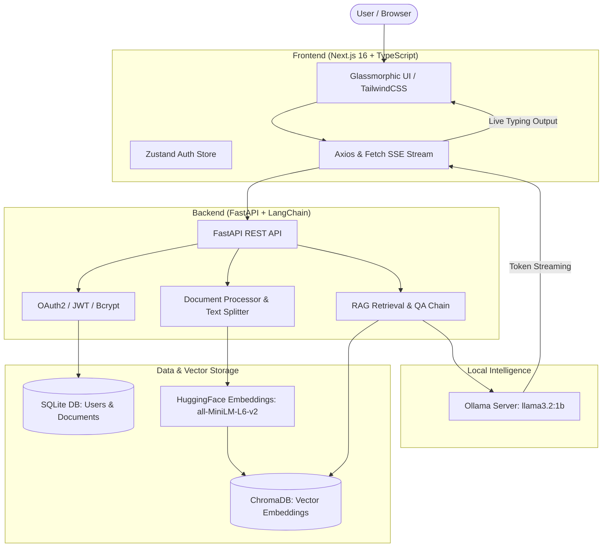

# 📄 Smart Document Analyzer (RAG)

An enterprise-ready, privacy-centric **Retrieval-Augmented Generation (RAG)** application. Upload documents (PDF, TXT), index them with local vector embeddings, and interactively query your knowledge base using locally hosted Large Language Models via Ollama — ensuring 100% data privacy with zero third-party cloud data exposure.

---

## 🏗️ Architecture Overview



---

## ✨ Features

- 🔒 **End-to-End Privacy**: Embeddings run locally with Hugging Face (`all-MiniLM-L6-v2`), and inference runs locally via Ollama (`llama3.2:1b`). No document text is sent to third-party APIs.
- 👥 **Multi-Tenant User Isolation**: Secure authentication with JWT tokens and bcrypt password hashing. Document chunks and vector queries are strictly isolated per user ID.
- ⚡ **Real-Time Streaming Responses**: Real-time token streaming using Server-Sent Events (SSE) for sub-second initial response latency.
- 📑 **Source Grounding & Citations**: Every generated response includes exact snippet extracts and source document references to prevent hallucinations.
- 🎯 **Targeted Multi-Document Filtering**: Select one or multiple documents to constrain your query, or search across your entire workspace.
- 🎨 **Modern Dark Glassmorphic UI**: Built with Next.js 16 (Turbopack), TailwindCSS, Framer Motion animations, and Zustand state persistence.

---

## 🛠️ Tech Stack

| Component | Technology | Description |
| :--- | :--- | :--- |
| **Frontend Framework** | Next.js 16 (App Router) | Modern React framework with Turbopack |
| **Language** | TypeScript | Strong typing across frontend and API models |
| **Styling** | TailwindCSS + Framer Motion | Sleek dark-mode aesthetic with micro-interactions |
| **State Management** | Zustand | Lightweight client state & auth persistence |
| **Backend Framework** | FastAPI | High-performance asynchronous Python API |
| **Orchestration** | LangChain Core & Community | RAG pipeline, document loaders, chunking & chains |
| **Vector Database** | ChromaDB | Persistent local vector store with metadata filtering |
| **Embedding Model** | `all-MiniLM-L6-v2` | Fast, high-accuracy 384-dimensional dense vectors |
| **Local LLM** | Ollama (`llama3.2:1b`) | Efficient local open-weights language model |
| **Database & ORM** | SQLite + SQLAlchemy | User credentials and document metadata storage |

---

## 📁 Repository Structure

```
Smart Document Analyzer (RAG)/
├── backend/
│   ├── app/
│   │   ├── api/             # API routes (auth, documents, chat)
│   │   ├── core/            # Configuration & security utilities
│   │   ├── database/        # Database session & base definitions
│   │   ├── models/          # SQLAlchemy ORM models (User, Document)
│   │   ├── schemas/         # Pydantic validation schemas
│   │   ├── services/        # RAG pipeline & vectorstore manager
│   │   └── main.py          # FastAPI application entrypoint
│   ├── .env.example         # Template for backend environment variables
│   └── requirements.txt     # Python dependencies
├── frontend/
│   ├── src/
│   │   ├── app/
│   │   │   ├── dashboard/   # Document management & interactive chat
│   │   │   ├── login/       # User sign-in page
│   │   │   ├── register/    # User registration page
│   │   │   ├── globals.css  # Global styles & design system
│   │   │   └── layout.tsx   # Root layout
│   │   ├── services/        # Axios API client & interceptors
│   │   ├── store/           # Zustand authentication store
│   │   └── utils/           # Utility helpers
│   ├── .env.example         # Template for frontend environment variables
│   ├── next.config.ts       # Next.js configuration
│   └── package.json         # Frontend dependencies & scripts
├── .gitignore               # Root gitignore (hides venv, DBs, node_modules, uploads)
└── README.md                # Project documentation
```

---

## 🚀 Quick Start Guide

### Prerequisites

Ensure you have the following installed on your machine:
- **Python 3.11+**
- **Node.js 18+** & `npm`
- **Ollama** ([Download Ollama](https://ollama.com/download))

---

### Step 1: Set Up & Start Ollama

1. Start the Ollama service:
   ```bash
   ollama serve
   ```
2. Pull the default lightweight model:
   ```bash
   ollama pull llama3.2:1b
   ```

---

### Step 2: Set Up & Start the Backend

1. Navigate to the `backend/` directory:
   ```bash
   cd backend
   ```

2. Create and activate a Python virtual environment:
   ```powershell
   # Windows PowerShell
   python -m venv venv
   .\venv\Scripts\Activate.ps1
   ```
   ```bash
   # macOS / Linux
   python3 -m venv venv
   source venv/bin/activate
   ```

3. Install dependencies:
   ```bash
   pip install -r requirements.txt
   ```

4. *(Optional)* Configure environment variables:
   ```bash
   cp .env.example .env
   ```

5. Launch the FastAPI server:
   ```bash
   uvicorn app.main:app --reload --port 8000
   ```
   *The interactive Swagger API documentation is accessible at: `http://localhost:8000/docs`*

---

### Step 3: Set Up & Start the Frontend

1. Open a new terminal and navigate to the `frontend/` directory:
   ```bash
   cd frontend
   ```

2. Install npm dependencies:
   ```bash
   npm install
   ```

3. *(Optional)* Set API endpoint environment variable:
   ```bash
   cp .env.example .env.local
   ```

4. Launch the Next.js development server:
   ```bash
   npm run dev
   ```

5. Open your browser and navigate to **`http://localhost:3000`**.

---

## 📡 API Endpoints Reference

### 🔐 Authentication (`/api/v1/auth`)
- `POST /api/v1/auth/register` — Create a new user account.
- `POST /api/v1/auth/login` — Authenticate and receive a JWT access token.
- `GET  /api/v1/auth/me` — Retrieve the current authenticated user's profile.

### 📄 Documents (`/api/v1/documents`)
- `POST /api/v1/documents/upload` — Upload a PDF or TXT file (automatically chunks & indexes into ChromaDB).
- `GET  /api/v1/documents/` — List all documents belonging to the authenticated user.
- `DELETE /api/v1/documents/{document_id}` — Delete a document from SQLite, filesystem, and ChromaDB vector store.

### 💬 Chat (`/api/v1/chat`)
- `POST /api/v1/chat/` — Submit a question with optional document ID filters; returns a real-time SSE token stream with citations.

---

## 🛡️ Security & Privacy Practices

- **Zero Cloud Leakage**: Documents are parsed, embedded, and queried entirely on your local machine.
- **Strict Data Isolation**: ChromaDB vector queries are tagged with `user_id` metadata filters, ensuring users can never query or access each other's documents.
- **Git Ignore Safeguards**: Sensitive data such as `.env`, SQLite databases (`sql_app.db`), local uploads (`uploaded_docs/`), ChromaDB index (`chroma_db/`), and virtual environments are excluded from Git commits.

---

## 📄 License

This project is licensed under the MIT License.
